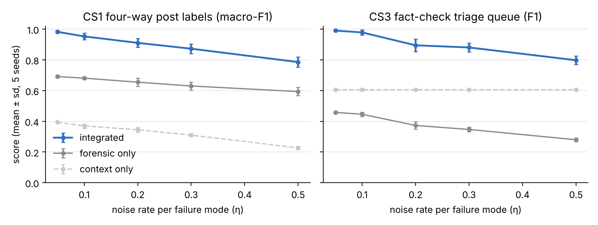
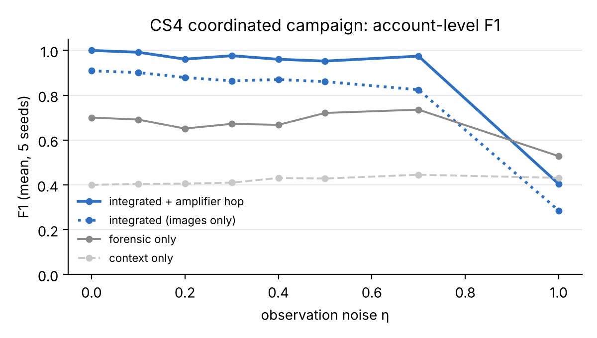
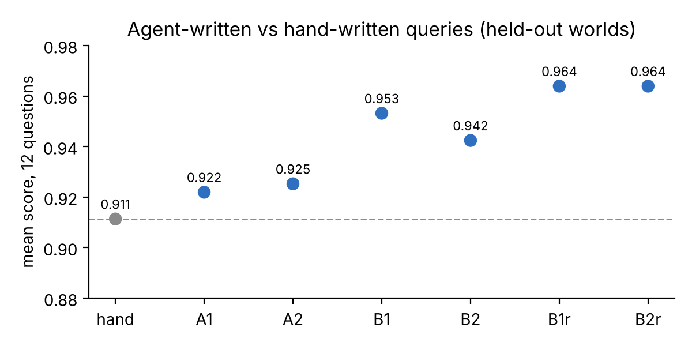

# FKG case studies: investigative queries over a Forensic Knowledge Graph

Code, synthetic data generators, SPARQL queries and results for the case studies that support the IEEE BIG paper on
Forensic Knowledge Graphs (FKG; Nguyen and Stamm, arXiv:2606.23917). The question every study asks is the same:
**once FKG records are encoded in RDF and share identifiers with dissemination, claims and the provenance of the
analysis, can a SPARQL query (written by hand or by an LLM agent) answer investigative questions that neither the
forensic layer nor the context layer answers alone?**

All data is synthetic and generated from fixed seeds. Every number measures whether queries recover planted ground
truth, not how a detector performs on real media.

## Results at a glance

| Study | Question | Integrated query | Best single layer |
|---|---|---|---|
| CS1 recycled media | Is an authentic photo presented as showing an event it predates? | accuracy 0.952 (4-way labels) | 0.743 (forensic only) |
| CS2 lineage and laundering | Which copy added the synthetic region; which platform did a file pass through; who credits an outlet for an edit it never published? | hidden hop 50/50; laundering P 1.00 R 1.00 | 15/50; P 0.137 |
| CS3 materiality and intent | Which undisclosed alterations touch what the claim is about? | triage precision 1.00 at recall 0.912 | 0.420 (context only) |
| CS4 coordinated campaign | Which accounts form a coordinated campaign using manipulated media? | F1 1.00 at noise 0, 0.97 at noise 0.7 | 0.70 (forensic only), 0.40 (context only) |





## Layout

| Path | What it holds |
|---|---|
| `_shared/` | FKG core ontology (`fkg-core.ttl`), context vocabulary (`fkg-context.ttl`), SHACL shapes, world builder, SPARQL runner (pyoxigraph), metrics, validator |
| `cs1_recycled_media/` | generator, world (`data/`, `heldout/`), queries, baselines and ablations, `run.py`, `results/` |
| `cs2_lineage_laundering/` | same layout; lineage is two CONSTRUCT rules (`q2a`, `q2b`) |
| `cs3_intent_materiality/` | same layout; the presentation/intent rule is `q3_intent_rule.rq` |
| `_catalog/` | the 18-use-case catalog (`catalog.json`), sketch queries, `check.py` |
| `robustness.py`, `robustness.{json,md}` | seed and noise sweep for CS1 to CS3 |
| `_audit/` | label-leak audit of the CS1 to CS3 generators (before and after the fix) |
| `agent_eval/` | 12 natural-language questions, the data notes agents read, every agent's answer set, scorer, scores (`preleak/` = scores before the leak fix) |
| `coordinated-campaign/` | CS4: its own ontology copy and shapes (`ontology/`), simulator (`sim/`), queries, evaluation and stress tests (`eval/`), LLM investigator runs (`agent/`), results |
| `scripts/make_figures.py`, `figures/` | the figures above, drawn from stored results |

CS1 to CS3 share one encoding (`_shared/`); CS4 was built in parallel with a slightly different one (per-producer named
graphs, `ni:` image IRIs, `fkg:FullySynthetic`). The differences are listed in the report as open questions.

## Reproduce

Dependencies are managed with [uv](https://docs.astral.sh/uv/) (`pyproject.toml`, pinned in `uv.lock`; Python 3.12 or newer).
Every make target runs through `uv run`, so the locked environment is used without activating anything.

```bash
uv sync           # create .venv from uv.lock (or: make setup)
make all          # validate, CS1-CS3, catalog, CS4 base evaluation, figures
make check        # query audit and reported-number tests (uv run pytest), a few minutes
make help         # every target
uv run python cs1_recycled_media/run.py   # any script runs the same way
```

| Result | Command | Time |
|---|---|---|
| SHACL conformance of CS1-CS3 worlds | `make validate` | seconds |
| CS1 / CS2 / CS3 tables | `make cs1`, `make cs2`, `make cs3` | under a minute each |
| Held-out worlds for agent scoring | `make heldout` | seconds |
| Noise sweep (CS1-CS3) | `make sweep` | about 10 minutes |
| Label-leak audit | `make audit` | minutes |
| Agent vs hand-written comparison | `make agents` | about an hour (one agent's lineage query is slow) |
| CS4 base evaluation (8 noise levels x 5 seeds, plus evasive variant) | `make campaign` | minutes |
| CS4 stress tests | `make campaign-stress EXPS="base scale_3"` | minutes to hours per experiment |
| Figures | `make figures` | seconds |
| Query audit and reported numbers | `make check` | a few minutes |

`make check` runs `tests/`: every query in the repository (hand-written, catalog, agent-written, CS4) must parse as SPARQL 1.1,
use only `fkg:`/`ctx:` terms its ontology declares, match only terms some generated world or rule contains, and (hand-written)
run; every query the report names must exist; and CS1-CS3 and CS4 (eta 0) are rerun and checked against the numbers the report
quotes. `uv run python scripts/check_queries.py` runs the same audit with the agent-written queries executed too (30 s timeout
each) and writes `results/query_audit.json`.

Seeds and noise rates are environment variables for CS1-CS3 (`FKG_SEED`, `FKG_ETA`, `FKG_DATA`). CS4 generators take
`--etas`, `--seeds` and `--behavior`. CS4 datasets are not committed (about 160 MB); `make campaign` regenerates them.

## Caveats

- Synthetic worlds: detector behaviour is parametric, platforms are a few transcoding profiles, credentials are summarised.
- The first CS1-CS3 generators leaked ground truth into detector false positives; this was found by an agent, fixed and
  audited (`_audit/`). CS4 ran its own audit (`coordinated-campaign/eval/leak_audit.py`).
- A pasted generated region carries a single-compression trace that the simulators record without noise, so queries
  that use it give upper bounds.
- The LLM investigator agents' model and version are to be filled in by the authors.

CS4 has one script per result in `coordinated-campaign/scripts/` (see its README); its write-up is the companion study doc linked from the report.
